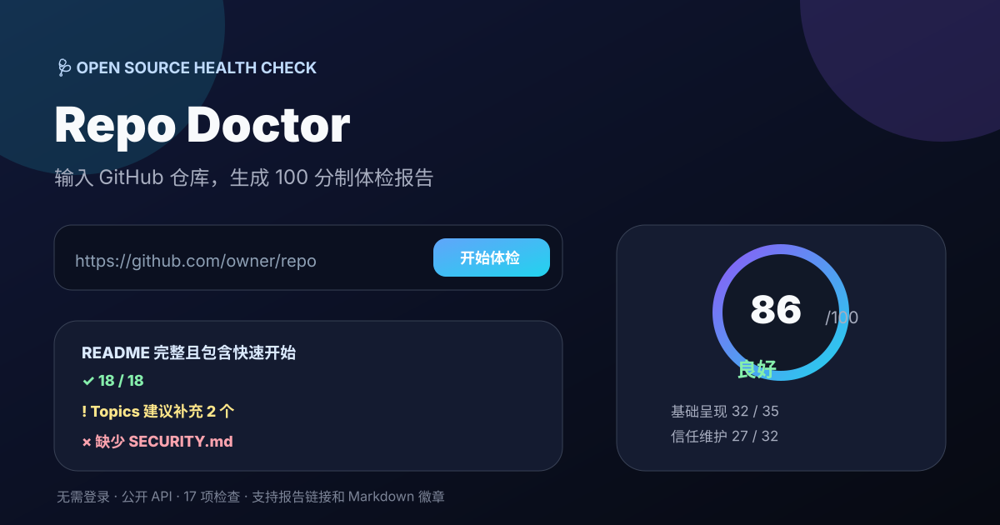

<div align="center">

# 🩺 Repo Doctor

**GitHub 仓库体检工具：检查开源项目是否具备“值得 Star”的基础条件**  
输入仓库地址，自动生成 100 分制健康报告

[](https://github.com/AnonymousLeeJJ/repo-doctor/stargazers)
[](LICENSE)
[](https://anonymousleejj.github.io/repo-doctor/)
[](CONTRIBUTING.md)

</div>

---

## 🤔 这是什么？

很多开源项目质量不差，但没人 Star。原因往往不是技术，而是：

- README 没讲清楚项目是什么
- 缺少许可证，用户不敢用
- 没有安装方法或使用示例
- 缺少截图或 Demo
- 没有贡献入口，别人想帮忙也不知道从哪开始

**Repo Doctor 会像体检一样检查这些关键项**，然后给出评分、问题清单和优先修复建议。

## 🌐 在线使用

👉 **https://anonymousleejj.github.io/repo-doctor/**

无需登录，无需安装，直接输入仓库地址：

```text
https://github.com/owner/repo
```

或：

```text
owner/repo
```

也可以直接访问带仓库参数的链接：

```text
https://anonymousleejj.github.io/repo-doctor/?repo=AnonymousLeeJJ/shuling-skill
```

## ✨ 功能

- 🧮 **100 分制评分**
- 🧩 **17 项开源健康检查**
- 📊 **分类得分：基础呈现 / 信任维护 / 社区协作 / 传播覆盖**
- 📋 **优先修复建议**
- 🔗 **可分享报告链接**
- 📛 **可复制 Markdown 徽章**
- 🔐 **无需登录，不收集用户数据**
- ⚡ **纯静态页面，无需后端**



## 🧪 检查模型

| 分类 | 分值 | 检查内容 |
| --- | ---: | --- |
| 基础呈现 | 35 | README 质量、快速开始、视觉演示、仓库元数据、徽章 |
| 信任维护 | 32 | 许可证、最近更新、Release、安全政策、Topics |
| 社区协作 | 23 | 贡献指南、Issue 模板、PR 模板、行为准则、赞助入口 |
| 传播覆盖 | 10 | 双语文档、适合分享的仓库描述 |

完整模型见 [`checks.json`](checks.json)，欢迎通过 PR 改进评分规则。

## 📊 评分示例

```markdown
[](https://anonymousleejj.github.io/repo-doctor/?repo=owner/repo)
```

评分等级：

- **90+**：优秀
- **75+**：良好
- **60+**：基础合格
- **40+**：需要改进
- **<40**：存在硬伤

## 🔐 隐私与 API 说明

- 工具运行在浏览器中，不收集任何用户数据
- 使用 GitHub 公共 API，仅读取公开仓库信息
- 未认证请求额度由访问者 IP 共享
- 私有仓库无法检查，GitHub 会返回 404
- 检查结果只代表项目包装质量，不代表代码质量或安全审计

## 🛣️ Roadmap

- [ ] 支持更多仓库健康指标
- [ ] 提供历史评分对比
- [ ] 生成完整 Markdown 体检报告
- [ ] 支持 GitHub Action 定期体检
- [ ] 提供可安装的 CLI 版本
- [ ] 支持多个仓库批量体检

## 🤝 贡献

欢迎参与：

- 改进评分模型
- 增加新的健康检查项
- 优化界面和报告展示
- 补充英文界面
- 提交真实仓库反馈

详见 [贡献指南](CONTRIBUTING.md)。

## 📄 许可

[MIT](LICENSE)

## 🔗 我的其他项目

- 🎯 [Awesome AI Prompts](https://github.com/AnonymousLeeJJ/awesome-ai-prompts) — 48 条实战验证的中文 AI 提示词，即复制即用
- 🔌 [Free APIs 中文精选](https://github.com/AnonymousLeeJJ/free-apis-zh) — 真正可用的免费 API 大全，标注是否需 Key
- 🧭 [AI Tools 导航](https://github.com/AnonymousLeeJJ/ai-tools-nav) — 国内外好用的 AI 工具精选，标注免费情况
- 📄 [Awesome Resume 简历模板](https://github.com/AnonymousLeeJJ/awesome-resume-zh) — 免费中文简历模板，浏览器直接导出 PDF
- ⚡ [开发者速查表](https://github.com/AnonymousLeeJJ/cheatsheets-zh) — Git/Docker/Linux/Vim/正则/HTTP/SQL 高频命令随查随用
- ✨ [Pure CSS Effects](https://github.com/AnonymousLeeJJ/pure-css-effects) — 纯 CSS 特效库，实时预览一键复制
- 📘 [Awesome README 中文模板](https://github.com/AnonymousLeeJJ/awesome-readme-zh) — 让人 30 秒决定点 Star 的 README 模板与指南
- 📚 [书灵.skill](https://github.com/AnonymousLeeJJ/shuling-skill) — 把书、课程或资料蒸馏成可调用的 AI 顾问
- 🧩 [Agent Skills 中文导航](https://github.com/AnonymousLeeJJ/awesome-agent-skills-zh) — 精选真实可用的 Agent Skills、合集与规范资源

---

<div align="center">

**如果 Repo Doctor 帮你发现了项目包装问题，请点个 ⭐ Star！**

</div>
